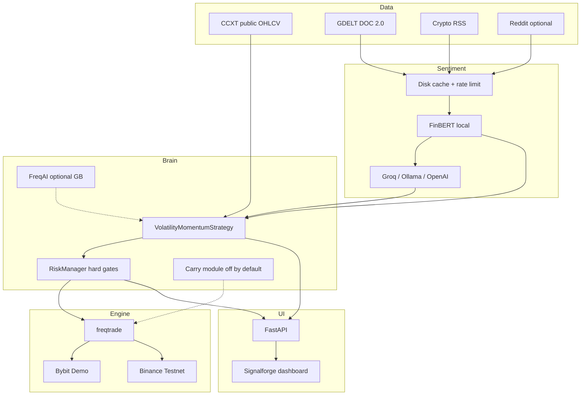

# Signalforge — AI Crypto Trading Bot

Production-oriented, open-source-style **demo/paper** crypto trading stack:

- **Engine:** [freqtrade](https://github.com/freqtrade/freqtrade) (GPL-3.0) as a dependency — not vendored
- **Exchange default:** [Bybit Demo Trading](https://bybit-exchange.github.io/docs/v5/demo) (`api-demo.bybit.com`) — Pakistan-friendly
- **Alternative:** [Binance Spot Testnet](https://testnet.binance.vision) (not licensed in Pakistan for live)
- **Data:** CCXT public OHLCV (no key)
- **Strategy:** volatility-scaled time-series momentum + cross-sectional tilt on BTC/ETH/large caps, with a **news-sentiment filter**
- **News:** GDELT DOC 2.0 + crypto RSS (no keys); optional Reddit
- **Sentiment:** local FinBERT first → pluggable LLM (Groq free tier default) with entity anonymisation, cache, rate limits → FinBERT/neutral on failure
- **Optional:** FreqAI gradient boosting; delta-neutral funding/basis carry (**off by default**)
- **Validation:** walk-forward, holdout, fees/slippage, deflated Sharpe / PBO; freqtrade lookahead/recursive analysis hooks

> **Honest accuracy:** No free method reliably beats ~51–55% daily directional accuracy out-of-sample. Target Sharpe after costs: **0.5–1.0**. Halve published edges. LLM never places trades or overrides hard risk rules.

## Architecture



## Quickstart

```bash
python -m venv .venv && source .venv/bin/activate
pip install -U pip
pip install -e ".[engine,dev]"          # freqtrade + test tooling
cp .env.example .env                    # add keys when ready
make download-data                      # public CCXT — no key
make validate                           # walk-forward + holdout
make dashboard                          # http://127.0.0.1:8080
```

Optional FinBERT / full stack:

```bash
pip install -e ".[engine,finbert,llm-groq,dev]"
```

Docker:

```bash
cp .env.example .env
docker compose up --build
```

Export freqtrade config and run (dry-run):

```bash
crypto-bot export-freqtrade-config
freqtrade backtesting -c config/freqtrade/config.json --strategy VolatilityMomentumStrategy
freqtrade lookahead-analysis -c config/freqtrade/config.json --strategy VolatilityMomentumStrategy
freqtrade recursive-analysis -c config/freqtrade/config.json --strategy VolatilityMomentumStrategy
```

## Live trading gate

Live is **off by default**. Enabling requires:

1. `LIVE_TRADING=true`
2. `LIVE_TRADING_CONFIRM=I_UNDERSTAND_LIVE_RISK`

Missing confirmation → startup `ValidationError`. Prefer 4–8 weeks of paper/demo matching backtest first.

## Accounts & API keys

| Service | Purpose | Free/Paid | Signup | Env var(s) | Required? | Pakistan |
|---|---|---|---|---|---|---|
| **GDELT DOC 2.0** | News headlines | Free | **None** | — | Recommended (built-in) | Yes |
| **Crypto RSS** (CoinDesk, Cointelegraph, etc.) | News headlines | Free | **None** | — | Recommended (built-in) | Yes |
| **CCXT public market data** | OHLCV | Free | **None** | — | Yes (built-in) | Yes |
| **FinBERT** (`ProsusAI/finbert`) | Local sentiment | Free (CPU/disk) | **None** (HuggingFace download) | — | Optional (`[finbert]`) | Yes |
| **Bybit Demo Trading** | Demo orders / private API | Free | [Bybit](https://www.bybit.com/) → Demo → API | `BYBIT_API_KEY`, `BYBIT_API_SECRET` | For private demo trading | **Yes** (default) |
| **Binance Spot Testnet** | Alt demo exchange | Free | [testnet.binance.vision](https://testnet.binance.vision) | `BINANCE_TESTNET_API_KEY`, `BINANCE_TESTNET_API_SECRET` | Optional alternative | Live Binance **not** licensed; testnet OK for practice |
| **Groq** | Optional LLM sentiment | Free tier (~30 rpm) | [console.groq.com](https://console.groq.com) | `GROQ_API_KEY` | Optional | Yes |
| **Ollama** | Local LLM | Free | [ollama.com](https://ollama.com) | `OLLAMA_BASE_URL`, `OLLAMA_MODEL` | Optional | Yes |
| **OpenAI** | Optional LLM | Paid | [platform.openai.com](https://platform.openai.com) | `OPENAI_API_KEY` | Optional | Yes |
| **Reddit API** | Optional news | Free non-commercial* | [reddit.com/prefs/apps](https://www.reddit.com/prefs/apps) | `REDDIT_CLIENT_ID`, `REDDIT_CLIENT_SECRET` | Optional (`NEWS_ENABLE_REDDIT`) | Yes |
| **CoinGecko Demo** | Optional metadata | Free tier | [coingecko.com/en/api](https://www.coingecko.com/en/api) | `COINGECKO_API_KEY` | Optional | Yes |

\*Reddit free access changes reported around late 2026 — keep `NEWS_ENABLE_REDDIT=false` if unavailable.

**Secrets:** copy `.env.example` → `.env` (gitignored). For CI/deploy, store in GitHub Actions secrets or server env — never commit keys.

## Project layout

```
src/crypto_bot/          # library + dashboard API
user_data/strategies/    # freqtrade strategy
config/                  # settings.yaml + freqtrade example
docs/                    # research KB, ADRs, runbooks
.cursor/                 # rules, skills, subagents
tests/                   # unit, integration, e2e
```

## Development

```bash
make install-dev
make lint
make typecheck
make test
```

See [AGENTS.md](./AGENTS.md) for agent conventions and [docs/](./docs/) for the knowledge base.

## License

GPL-3.0-or-later (compatible with freqtrade).
